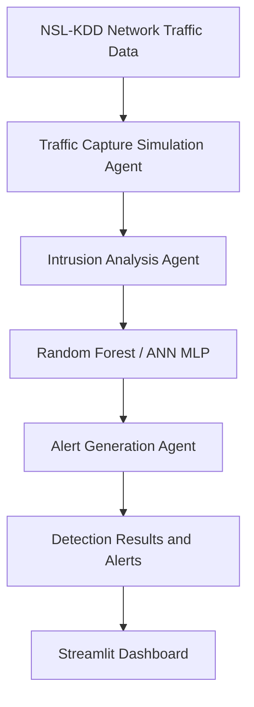

# AI-Agent-Based Network Intrusion Detection System (AI-Agent IDS)

**Final-Year Dissertation | BEng Computer Science | Anglia Ruskin University**

An AI-agent-based Network Intrusion Detection System (NIDS) developed to identify potentially malicious network activity using machine learning. The project combines a simulated traffic-monitoring workflow, intrusion analysis and automated alert generation to demonstrate how intelligent detection systems can support security monitoring and threat investigation.

## 1. Key Features

- **Multi-agent architecture:** Three cooperating agents for traffic capture simulation, intrusion analysis and alert generation.
- **Machine learning detection:** Implements and compares Random Forest and Artificial Neural Network (ANN/MLP) classifiers.
- **NSL-KDD dataset:** Uses a recognised benchmark dataset for network intrusion detection research.
- **Threshold optimisation:** Evaluates different decision thresholds to investigate detection performance.
- **Feature importance analysis:** Examines which network features contribute most to Random Forest predictions.
- **Interactive dashboard:** Streamlit-based interface for presenting detection results and monitoring alerts.
- **Visual analytics:** Performance comparisons and evaluation visualisations.

## 2. System Architecture

The system follows a three-agent design, with each agent responsible for a different stage of the intrusion detection workflow.

1. **Traffic Capture Simulation Agent:** Simulates the collection and provision of network traffic records for analysis.
2. **Intrusion Analysis Agent:** Processes traffic records and uses trained machine learning models to identify potentially suspicious activity.
3. **Alert Generation Agent:** Produces alerts when traffic is classified as potentially malicious.

### Architecture Diagram



## 3. Dataset

The project uses the **NSL-KDD dataset**, a benchmark dataset designed for network intrusion detection research.

It contains network connection records with labelled normal and attack traffic.

Dataset files used:

- `KDDTrain+.txt`
- `KDDTest+.txt`

The dataset is stored locally in the `Data/` directory.

**Preprocessing methodology:**
- Data loading: [TODO: fill in]
- Handling categorical features: [TODO: fill in]
- Encoding and feature transformation: [TODO: fill in]
- Missing-value handling: [TODO: fill in]
- Training and testing split: [TODO: fill in exact proportions and methodology]

## 4. Machine Learning Models

Two machine learning approaches were implemented and compared.

### Random Forest

An ensemble learning algorithm that combines multiple decision trees to classify network traffic.

It was evaluated for its classification performance and ability to identify influential network features.

### Artificial Neural Network (ANN/MLP)

A Multi-Layer Perceptron classifier used to investigate whether a neural-network-based approach could improve intrusion detection performance.

**Model configuration:**

| Setting | Random Forest | ANN (MLP) |
|---|---|---|
| Algorithm | Random Forest Classifier | MLP Classifier |
| Number of estimators / layers | [TODO: fill in] | [TODO: fill in] |
| Hyperparameters | [TODO: fill in] | [TODO: fill in] |
| Feature inputs | [TODO: fill in] | [TODO: fill in] |

Both models were evaluated to compare their ability to distinguish normal network activity from potential intrusions.

## 5. Model Evaluation and Results

The models were evaluated using standard classification metrics.

The project includes performance comparison charts, ROC and Precision-Recall curves, confusion matrix analysis and threshold optimisation.

### Performance Comparison

| Evaluation Metric | Random Forest | ANN (MLP) |
|---|---:|---:|
| Accuracy | [TODO: fill in] | [TODO: fill in] |
| Precision | [TODO: fill in] | [TODO: fill in] |
| Recall | [TODO: fill in] | [TODO: fill in] |
| F1-score | [TODO: fill in] | [TODO: fill in] |

*The numerical results will be added from the final model evaluation outputs.*

### Confusion Matrix Analysis

- **Random Forest:** [TODO: describe true positives, true negatives, false positives and false negatives using the final confusion matrix.]
- **ANN (MLP):** [TODO: describe the corresponding results.]

### Decision Threshold Optimisation

Threshold tuning was performed to investigate how changing the classification decision threshold affects intrusion detection performance.

The project includes threshold-sweep visualisations for both Random Forest and ANN (MLP), allowing comparison of the trade-off between detecting attacks and generating false alerts.

### Feature Importance

Random Forest feature importance and permutation importance analyses were generated.

Top contributing features:

[TODO: insert the actual top five features and their importance values from the final results.]

## 6. Interactive Dashboard

The project includes a Streamlit application (`app.py`) that provides an interface for presenting intrusion detection results.

The dashboard is designed to display detection information and supporting visualisations.

**Dashboard screenshots:**

[TODO: Insert screenshot of the main dashboard]

[TODO: Insert screenshot of intrusion detection results]

[TODO: Insert screenshot of generated alerts]

## 7. Technology Stack

| Technology | Purpose |
|---|---|
| Python | Core programming language |
| Scikit-learn | Machine learning models and evaluation |
| Pandas | Dataset processing and manipulation |
| NumPy | Numerical operations |
| Streamlit | Interactive dashboard |
| Plotly | Data visualisation |
| Jupyter Notebook | Model development and experimentation |
| Git & GitHub | Version control and project management |

## 8. Installation and Execution

### Prerequisites

- Python 3.9 or later [TODO: confirm tested version]
- pip
- Git

### Clone the Repository

```bash
git clone https://github.com/MADHAV-1212/NIDS.git
cd NIDS
```

### Create a Virtual Environment

```bash
python -m venv .venv
```

Activate it on Windows:

```powershell
.venv\Scripts\activate
```

### Install Dependencies

```bash
pip install streamlit pandas numpy scikit-learn plotly jupyter
```

*TODO: Add a verified `requirements.txt` containing all project dependencies and tested versions.*

### Run the Dashboard

```bash
streamlit run app.py
```

### Project Structure

```text
AI-AGENT-IDS/
│
├── artifacts/
│   ├── alerts_detected.csv
│   ├── alerts_live.csv
│   ├── model_eval_summary.csv
│   ├── model_eval_summary_final.csv
│   ├── performance_comparison_final.png
│   ├── performance_comparison_testset.png
│   ├── rf_feature_importance.png
│   ├── rf_permutation_importance.csv
│   ├── rf_permutation_importance.png
│   ├── roc_pr_curves.png
│   ├── roc_rf_vs_ann.png
│   ├── stream_results_sample.csv
│   └── threshold sweep visualisations
│
├── Data/
│   ├── KDDTrain+.txt
│   └── KDDTest+.txt
│
├── app.py
├── project.ipynb
├── .gitignore
└── README.md
```

**Note:** The dataset is stored locally and may need to be obtained separately. Confirm the actual tracked repository contents before relying on this folder structure.

## 9. Limitations

- The system uses the NSL-KDD benchmark dataset rather than unrestricted live network traffic.
- Traffic capture is simulated rather than performed through a live network interface.
- Performance on benchmark data does not guarantee equivalent performance in real-world environments.
- Changes in network behaviour and emerging attack techniques could introduce model drift.
- False positives may generate additional investigation work for security analysts.
- The system has not been established as a production-ready intrusion detection platform.

## 10. Security Relevance and Future Development

This project demonstrates practical applications of machine learning in network security monitoring.

The generated alerts can help an analyst investigate potentially malicious activity, distinguish suspicious connections from normal traffic and understand the characteristics influencing model predictions.

The project also provides a foundation for further development, including:

- Integration with live network traffic capture.
- SIEM integration for centralised security monitoring.
- Improved alert prioritisation and investigation workflows.
- Evaluation against additional network intrusion datasets.
- Monitoring and retraining to address model drift.
- Further reduction of false-positive detection rates.

## 11. Author

**Madhav**

BEng Computer Science  
Anglia Ruskin University

**GitHub Repository:**  
https://github.com/MADHAV-1212/NIDS

**Project:** AI-Agent-Based Network Intrusion Detection System

---

*Developed as a final-year undergraduate dissertation project in Computer Science.*
